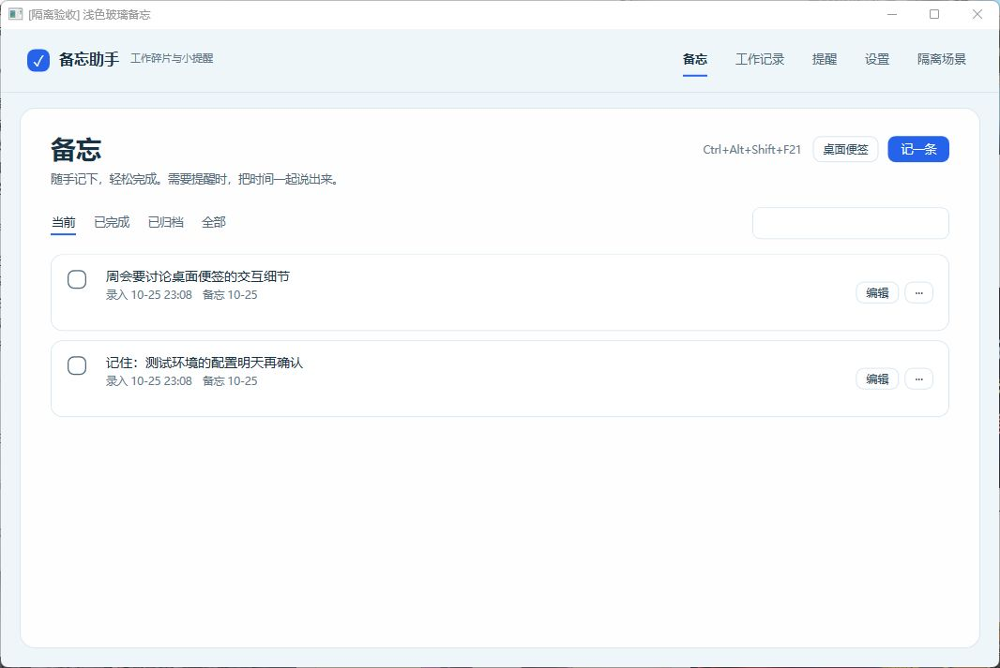
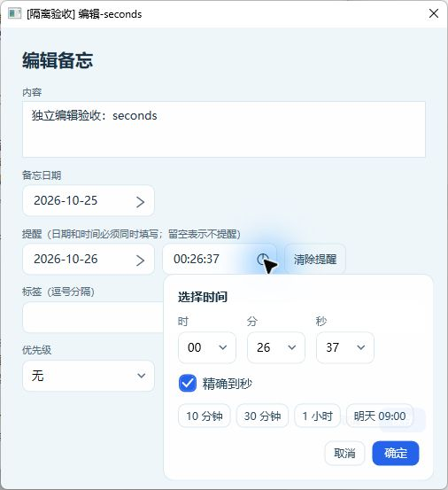
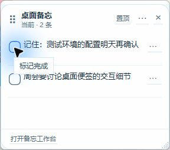
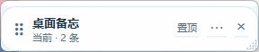

# MemoDesk · 备忘助手

**一句话记下来，到点提醒你。**

一个为个人 Windows 办公电脑设计的轻量备忘工具。按下全局快捷键，输入一句话，回车即可保存；需要提醒时，把时间一起说出来。备忘可以留在桌面，完成时直接打勾，工作记录自动按时间留痕。

`Windows 10 / 11` · `.NET 10` · `WPF` · `SQLite` · `DeepSeek`



## 为什么做这个

工作中经常会冒出一些小事：几分钟后回个消息、记住一个细节、稍后处理一件事。打开任务管理软件再选分类、填表单，很容易打断手头的工作。

MemoDesk 把常用操作缩短为 **快捷键 → 一句话 → 回车**。内容先在本地保存，AI 在后台整理；没有待确认步骤，也不用先分辨待办和备忘。工作记录则从录入、完成等事件中回看。

## 主要功能

- **随手记录**：全局快捷键唤起输入框，回车保存，Esc 取消，Shift+Enter 换行；保留完整原文。
- **秒级提醒**：`3s后提醒我喝水` 等明确的相对提醒在本地同步建立，不必等待 AI 响应。
- **后台整理**：DeepSeek 补充内容、标签、发生时间和明确提醒；人工修改、完成、归档优先，晚到的结果不会覆盖操作。
- **Windows 原生通知**：到点优先使用系统通知，支持完成和固定选项的稍后提醒；明确失败时可使用轻量卡片兜底。
- **桌面便签**：直接勾选完成，支持置顶、折叠、锁定位置、隐藏和调整大小；只通过把手拖动。
- **时间可选也可输**：日期日历与时分秒面板统一样式，支持 `HH:mm`、`HH:mm:ss`；无效输入不会被静默保存。
- **工作记录与搜索**：按日期回顾录入及完成事件，按关键词查找内容、原文和标签。
- **浅色玻璃主题**：冷白底、蓝青强调和圆角卡片；根据 Windows 能力和系统设置使用材质或实色回退。
- **快捷键录制**：在设置里直接按组合键绑定，页面提示跟随实际注册值更新。
- **后台常驻**：关闭主窗口只隐藏到托盘，退出程序通过托盘菜单完成。

## 界面预览

下图使用隔离验收窗口和示例数据，展示实际 WPF 控件。

### 时分秒选择



### 桌面备忘

<p>
  
  
</p>

默认保留今日及往日未完成内容，也可切换为仅今日。左侧勾选即可完成；编辑、归档、删除放在更多菜单中。

### 提醒兜底卡片


系统通知是主通道。交接结果未知时先核对历史，不立即叠加卡片或重复发送；关闭卡片也不会把备忘自动标记完成。

## 快速开始

当前仓库提供源码。建议使用 Windows 11 x64 和 [.NET 10 SDK](https://dotnet.microsoft.com/download/dotnet/10.0)；`global.json` 固定 .NET 10 分支并允许后续功能版本。

```powershell
git clone https://github.com/Fishtail-boy/MemoDesk.git
cd MemoDesk
dotnet restore MemoDesk.sln
dotnet build MemoDesk.sln -c Release
dotnet run --project src/MemoDesk.App -c Release
```

首次启动后：

1. 进入设置，确认全局快捷键。默认是 `Ctrl+Alt+Space`，可点击“重新绑定”后直接按键录制。
2. 如需后台 AI 整理，填写 DeepSeek API Key；接口地址、模型名称都可调整，模型应使用账号实际可用的名称。
3. 在设置中点击“测试系统通知”，查看本机通知通道状态。
4. 按快捷键，输入一句话并回车。备忘立即保存，桌面便签和工作记录同步更新。

没有配置 API Key 或暂时断网时，原文备忘和明确的本地相对提醒仍可用。

### 输入示例

```text
3s后提醒我喝水
30秒后提醒我看一下下载结果
1分30秒后提醒我起来活动
明天下午三点提醒我开会
记住这个接口还有一个兼容性问题
刚刚完成了接口联调
```

前三类明确的单事项相对命令可走本地即时通道；复杂时间、多事项等内容由后台 AI 整理，再通过本地规则校验。没有明确时间的内容不会凭空增加提醒。AI 生成的结果始终可以编辑。

### 导出可直接运行的版本

```powershell
dotnet publish src/MemoDesk.App/MemoDesk.App.csproj `
  -c Release -r win-x64 --self-contained true `
  -o artifacts/MemoDesk-win-x64
```

运行输出目录中的 `MemoDesk.App.exe`，整个目录需要一起保留。自包含发布包含 .NET 运行库，Windows App SDK 的原生依赖也会随构建整理到输出目录。

更新时先从托盘退出旧版，再启动新版。单实例机制会把第二次启动转交给已运行的进程，因此仅关闭旧版主窗口不会切换到新程序。

MSIX 打包和签名说明见 [packaging/README.md](packaging/README.md)。签名证书及本机数据不进入仓库。

## 数据与隐私

- 备忘、原文、设置和记录保存在本机 SQLite 数据库，默认目录为 `%LOCALAPPDATA%\MemoDesk\`。
- 启用 AI 整理后，**完整原文会发送到配置的 DeepSeek API 或兼容接口**，不做自动脱敏。
- API Key 使用 Windows DPAPI 按当前用户加密后存储，不明文写入数据库或日志。
- 明确的本地相对提醒不依赖 AI 响应；后台整理失败不会导致原文丢失。
- 本项目当前不提供云同步、多人协作或手机端。

## 技术结构

```text
src/
├─ MemoDesk.Core/              领域模型、时间规则、捕获、解析和提醒状态机
├─ MemoDesk.Infrastructure/    SQLite、增量迁移、查询、设置和 DeepSeek 客户端
├─ MemoDesk.Platform.Windows/  热键、托盘、通知、窗口、DPAPI 和单实例
└─ MemoDesk.App/               WPF + MVVM 界面与后台服务
tests/
├─ MemoDesk.Core.Tests/
└─ MemoDesk.Infrastructure.Tests/
packaging/                    MSIX 清单与构建脚本
docs/screenshots/             使用示例数据的界面截图
```

依赖方向为 `App → Platform.Windows / Infrastructure → Core`。本地捕获将原文、备忘、录入事件与明确提醒放入同一事务，AI 结果异步补充，用户操作优先。

提醒采用计划版本、唯一实例、原子领取和租约防止重复。短时相对提醒使用单调时钟，UTC 目标用于持久化和重启恢复；完成、编辑和稍后操作会让旧通知动作失效。

## 验证状态

当前版本为 **0.9.0 预览版**。最近一轮在 Windows 11 完成：

- Release 编译：0 警告、0 错误。
- 单元与数据库集成测试：**211 项通过**，其中 Core 104、Infrastructure 107。
- 新增体验探针：**9 项通过**，覆盖三秒计时、通知去重、时间校验、秒数往返、兜底与立即提醒等。
- 原有备忘与日期检查 48 项、历史流程及提醒检查 56 项通过。
- 独立 Windows 窗口验证了主界面、时分秒选择、便签勾选同步、折叠、归档和兜底卡片。
- 未打包宿主完成了 Windows 原生通知注册和测试请求交接。

运行测试：

```powershell
dotnet test MemoDesk.sln -c Release
```

独立体验探针使用合成数据和伪通知通道，默认不调用真实 AI，也不读取正式备忘数据：

```powershell
dotnet run --project docs/implementation-results/2026-10-25-experience-upgrade/MemoFirstProbe/MemoFirstProbe.csproj `
  -c Release -- --experience-checks
```

### 已知边界

- 目标兼容 Windows 10 22H2 / Windows 11 x64；Windows 10、100%–200% DPI、多屏热插拔和休眠恢复仍需专项实测。
- 系统通知“已交接”表示 Windows 接收请求，不等于用户已经看到横幅；勿扰和系统设置会影响呈现。
- 系统计划通知、MSIX 安装及真实通知按钮的冷启动仍需专项验证。程序未运行且没有系统计划时，需要下次启动补提醒。
- 支持的 Windows 11 使用公开 DWM 材质；Windows 10、关闭透明、高对比度及节电等环境会采用实色回退。
- AI 对复杂表达的理解受模型影响。短时提醒受系统调度和负载影响，不承诺硬实时精度。
- 第一版不包含开机自启、复杂项目管理、外部办公系统集成或自动生成工作总结。

## 反馈

欢迎通过 [Issues](https://github.com/Fishtail-boy/MemoDesk/issues) 提交问题。建议说明系统版本、复现步骤、预期结果和实际结果；截图、日志请先去除个人内容与 API Key。

## 许可证

本仓库暂未指定项目许可证；依赖组件的许可证见对应 NuGet 包及其说明。
