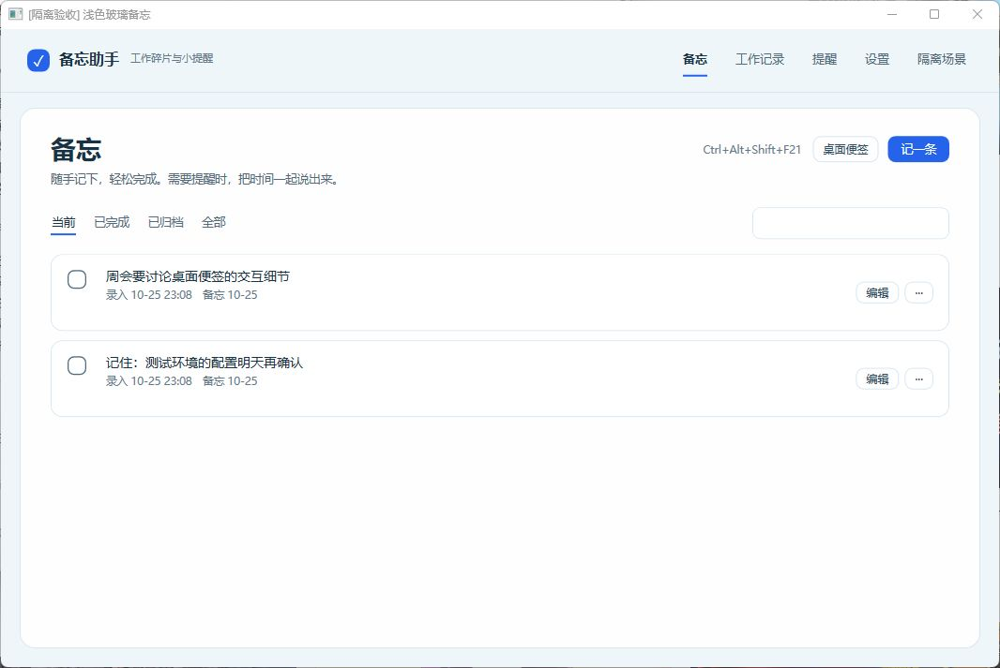
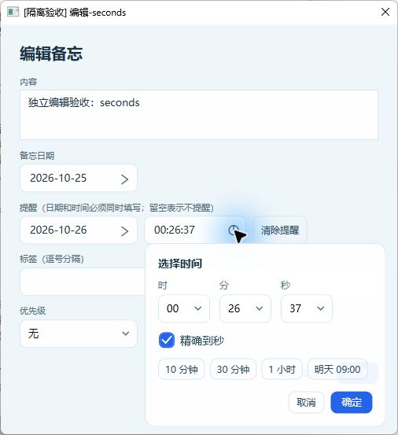
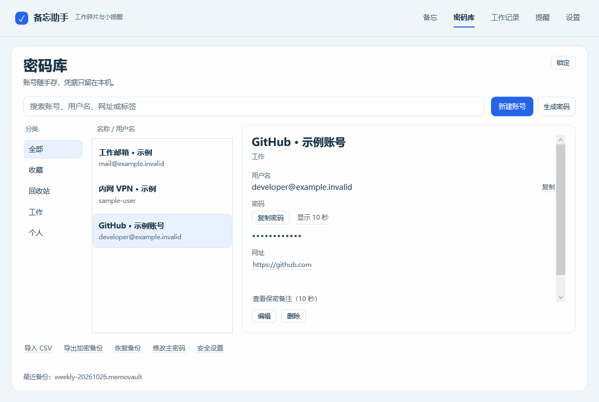

# MemoDesk · 备忘助手

**一句话记下来，到点提醒你。**

一个为个人 Windows 办公电脑设计的轻量备忘工具。按下全局快捷键，输入一句话，回车即可保存；需要提醒时，把时间一起说出来。备忘可以留在桌面，完成时直接打勾，工作记录自动按时间留痕。

`Windows 10 / 11` · `.NET 10` · `WPF` · `SQLite` · `DeepSeek`

当前源码为 **0.11.0-rc.3 候选版**，新增数字资产管理和可左右滑动的灵动岛资产模块。安装和升级说明见 [发行说明](docs/releases/v0.11.0-rc.3.md)。



## 为什么做这个

工作中经常会冒出一些小事：几分钟后回个消息、记住一个细节、稍后处理一件事。打开任务管理软件再选分类、填表单，很容易打断手头的工作。

MemoDesk 把常用操作缩短为 **快捷键 → 一句话 → 回车**。内容先在本地保存，AI 在后台整理；没有待确认步骤，也不用先分辨待办和备忘。工作记录按录入时间回看。

## 主要功能

- **随手记录**：全局快捷键唤起输入框，回车保存，Esc 取消，Shift+Enter 换行；保留完整原文。
- **秒级提醒**：`3s后提醒我喝水` 等明确的相对提醒在本地同步建立，不必等待 AI 响应。
- **后台整理**：DeepSeek 补充内容、标签、发生时间和明确提醒；人工修改、完成、归档优先，晚到的结果不会覆盖操作。
- **Windows 原生通知**：到点优先使用系统通知，支持完成和固定选项的稍后提醒；明确失败时可使用轻量卡片兜底。
- **桌面岛**：默认停靠在屏幕顶部。鼠标停留展开，移开自动收起；可从岛上的「⋯」菜单切换到左右侧边、保持展开或关闭置顶。岛内可直接记录和完成备忘，用月历查看每天的提醒。
- **消息与额度**：消息页查看到期备忘，可开启微信任务栏闪动提醒并打开对应窗口。额度页用已登录的 Codex 客户端读取可用额度与重置时间，用设置里的官方 DeepSeek API Key 查询余额。可开启自动刷新和 Codex 到时提示。
- **时间可选也可输**：日期日历与时分秒面板统一样式，支持 `HH:mm`、`HH:mm:ss`；无效输入不会被静默保存。
- **工作记录与搜索**：按日期回顾备忘录入记录，按关键词查找内容、原文和标签。
- **数字资产**：登记服务器、域名、账号会员等资产，查看到期日期与时刻、简介和管理链接。可在工作台搜索和筛选，也可从灵动岛的备忘页向左滑动查看。
- **本地密码库**：独立主密码、账号管理、分类收藏、密码生成、快捷检索、CSV 导入和加密备份；密码数据不进入备忘与 AI。
- **自动锁定与安全复制**：隐藏、最小化、系统锁屏和休眠时锁库；闲置默认 5 分钟锁定，复制的凭据 20 秒后清除，并拒绝系统剪贴板历史和云同步。
- **经典深色界面**：黑色胶囊、深灰卡片与绿色强调色，支持 Windows 高对比度。
- **快捷键录制**：在设置里直接按组合键绑定，页面提示跟随实际注册值更新。
- **后台常驻**：关闭主窗口只隐藏到托盘，退出程序通过托盘菜单完成。

## 界面预览

下图使用隔离验收窗口和示例数据，展示实际 WPF 控件。

### 时分秒选择



### 桌面岛

Daozai 原生版由发布目录下的 Island 子目录提供。它沿用 Daozai 的岛体动画、翻页、皮肤、拖动和停靠。备忘页的「加一个」直接写入 MemoDesk，向左滑进入数字资产页。「工作台」和「密码库」会打开岛仔设置窗口，侧栏提供备忘、密码库、数字资产、工作记录、提醒及备忘设置。

构建时用 PowerShell 7 运行 `./packaging/build-portable.ps1 -BuildDaozaiIsland`。原生岛需要 Rust MSVC 工具链与 Windows SDK，构建脚本会获取固定提交的上游源码并应用适配。常规 .NET 构建可独立运行。

原生岛的额度账号在岛仔设置的「AI 额度」中连接，微信提示在岛仔通知设置中调整。岛仔的外观与功能设置保存在 MemoDesk 数据目录的 `island` 子目录，备忘和密码库仍使用现有 SQLite 数据库。

### WPF 桌面岛

把鼠标移到胶囊上，或点击胶囊展开。底部页签和左右箭头可在备忘、数字资产、日程、消息和额度间切换。备忘页默认显示今天及更早的未完成项，右上角可新建，「全部备忘」打开工作台。桌面岛隐藏后，可从托盘重新显示。

微信提醒使用 Windows 的任务栏闪动信号。Codex 查询通过本机客户端的账号额度接口，DeepSeek 的余额响应提供可用金额。桌面岛与分页交互参考 [岛仔 Daozai](https://github.com/Fishtail-boy/daozai)。

### 提醒兜底卡片


系统通知是主通道。交接结果未知时先核对历史，不立即叠加卡片或重复发送；关闭卡片也不会把备忘自动标记完成。

## 快速开始

从 [最新候选版](https://github.com/Fishtail-boy/MemoDesk/releases/tag/v0.11.0-rc.3) 下载 Windows x64 安装包，按向导安装后从开始菜单启动。更新前请从托盘退出旧版本。安装包无需另装 .NET，尚未签名。

如需从源码构建，建议使用 Windows 11 x64 和 [.NET 10 SDK](https://dotnet.microsoft.com/download/dotnet/10.0)；`global.json` 固定 .NET 10 分支并允许后续功能版本。

```powershell
git clone https://github.com/Fishtail-boy/MemoDesk.git
cd MemoDesk
dotnet restore MemoDesk.sln
dotnet build MemoDesk.sln -c Release
dotnet run --project src/MemoDesk.App -c Release
```

首次启动后：

1. 进入设置，确认全局快捷键。默认是 `Ctrl+Alt+Space`，可点击“重新绑定”后直接按键录制。
2. 如需后台 AI 整理，填写 DeepSeek API Key；接口地址、模型名称都可调整，模型应使用账号实际可用的名称。
3. 在设置中点击“测试系统通知”，查看本机通知通道状态。
4. 按快捷键，输入一句话并回车。备忘立即保存，桌面便签和工作记录同步更新。

没有配置 API Key 或暂时断网时，原文备忘和明确的本地相对提醒仍可用。

### 使用密码库

进入顶部“密码库”，设置 10–1024 字符的主密码，即可新建账号、生成密码、分类收藏和搜索。支持中文和空格，不要求特定字符组合；格式错误会在输入框附近显示具体原因，并保留输入。`Ctrl+Alt+P` 打开快捷检索；Enter 复制密码，Ctrl+Enter 复制用户名，Esc 关闭。组合键和 1 / 5 / 15 分钟自动锁定时间可在密码库的“安全设置”修改。

密码库不提供主密码找回。请通过“导出加密备份”保存 `.memovault` 文件，并保管好对应主密码；修改主密码后，旧备份仍需要旧密码。恢复在校验完成后替换整库，原库另存一份加密数据库快照。



CSV 导入支持本地字段映射、预览与重复条目处理；密码不会出现在预览中。普通快捷记录仍会按已启用的 AI 规则发送原文，账号和密码请从专用密码库入口录入。

详细格式、保护边界和验证说明见 [密码库说明](docs/password-vault/README.md)。

### 输入示例

```text
3s后提醒我喝水
30秒后提醒我看一下下载结果
1分30秒后提醒我起来活动
明天下午三点提醒我开会
记住这个接口还有一个兼容性问题
刚刚完成了接口联调
```

前三类明确的单事项相对命令可走本地即时通道；复杂时间、多事项等内容由后台 AI 整理，再通过本地规则校验。没有明确时间的内容不会凭空增加提醒。AI 生成的结果始终可以编辑。

### 导出可直接运行的版本

推荐一键完成编译、测试、隔离界面验收和打包（需交互式 Windows 桌面）：

```powershell
./packaging/build-portable.ps1 -RunUiChecks
```

非交互 CI 可省略 `-RunUiChecks`，执行相同的编译、单元/集成测试和发布流程；该 CI 已配置，尚未在远端运行。备忘备份与恢复见 [使用说明](packaging/PORTABLE-README.md)。仅需发布目录时也可执行：

```powershell
dotnet publish src/MemoDesk.App/MemoDesk.App.csproj `
  -c Release -r win-x64 --self-contained true `
  -o artifacts/MemoDesk-win-x64
```

运行输出目录中的 `MemoDesk.exe`，整个目录需要一起保留。自包含发布包含 .NET 运行库，Windows App SDK 的原生依赖也会随构建整理到输出目录。

更新时先从托盘退出旧版，再启动新版。单实例机制会把第二次启动转交给已运行的进程，因此仅关闭旧版主窗口不会切换到新程序。

MSIX 打包和签名说明见 [packaging/README.md](packaging/README.md)。签名证书及本机数据不进入仓库。

## 数据与隐私

- 备忘、原文、设置和记录保存在本机 SQLite 数据库，默认目录为 `%LOCALAPPDATA%\MemoDesk\`。
- 启用 AI 整理后，**完整原文会发送到配置的 DeepSeek API 或兼容接口**，不做自动脱敏。
- API Key 使用 Windows DPAPI 按当前用户加密后存储，不明文写入数据库或日志。
- 密码库独立存储于 `%LOCALAPPDATA%\MemoDesk\vault\vault.db`。主密码通过 PBKDF2-HMAC-SHA256 派生密钥，账号元信息、密码和备注使用 AES-256-GCM 加密后写入 SQLite；这些数据不调用 AI，也不写入备忘、通知和日志。
- 密码库结构、随机 ID 和数量等元信息仍可见；WPF 字符串无法保证从进程内存完全抹除。该功能目前是预览版，尚未经过独立安全审计。
- 明确的本地相对提醒不依赖 AI 响应；后台整理失败不会导致原文丢失。
- 本项目当前不提供云同步、多人协作或手机端。

## 技术结构

```text
src/
├─ MemoDesk.Core/              领域模型、时间规则、捕获、解析和提醒状态机
├─ MemoDesk.Infrastructure/    SQLite、增量迁移、查询、设置和 DeepSeek 客户端
├─ MemoDesk.Platform.Windows/  热键、托盘、通知、窗口、DPAPI 和单实例
├─ MemoDesk.App/               WPF + MVVM 界面与后台服务
├─ MemoDesk.Vault.Core/        密码库领域模型、搜索、生成器和 CSV 解析
└─ MemoDesk.Vault.Infrastructure/ 独立加密存储、主密码信封与备份恢复
tests/
├─ MemoDesk.Core.Tests/
└─ MemoDesk.Infrastructure.Tests/
packaging/                    MSIX 清单与构建脚本
docs/screenshots/             使用示例数据的界面截图
```

依赖方向为 `App → Platform.Windows / Infrastructure → Core`。本地捕获将原文、备忘、录入事件与明确提醒放入同一事务，AI 结果异步补充，用户操作优先。

提醒采用计划版本、唯一实例、原子领取和租约防止重复。短时相对提醒使用单调时钟，UTC 目标用于持久化和重启恢复；完成、编辑和稍后操作会让旧通知动作失效。

## 验证状态

**0.11.0-rc.3** 的测试涵盖备忘和密码库回归、数字资产保存与数据库升级、原生灵动岛横滑和 WPF 页面切换。详见 [发行说明](docs/releases/v0.11.0-rc.3.md)。

以下保留 **0.10.3-preview** 于 2026-11-01 的历史验证：

- Release 编译：0 警告、0 错误。
- 单元与数据库集成测试：**261 项通过**，其中 Core 104、Infrastructure 107、Vault 50。新增主密码 9/10/11 字符边界、10 字符建库、重开及修改口令验证。
- 密码库实际 WPF 验收：本轮 **40 项通过**，使用 10 字符主密码验证建库、解锁和备份恢复，检查 9 字符拒绝及界面提示与规则一致，并回归安全复制和锁定等流程；本轮使用替身剪贴板。
- 本次 3 项 review 问题的修复与证据见[修复记录](docs/password-vault/review-fixes-2026-11-01.md)。

此前已完成的验证（本轮未重复运行）：

- 原生剪贴板格式、所有权与到期清理已在 0.10.0 的验收中通过；见[首版验证记录](docs/password-vault/validation-2026-10-31.md)。0.10.1 的主密码提示修复见[修复记录](docs/password-vault/master-password-validation-2026-10-31.md)。
- 新增体验探针：**9 项通过**，覆盖三秒计时、通知去重、时间校验、秒数往返、兜底与立即提醒等。
- 原有备忘与日期检查 48 项、历史流程及提醒检查 56 项通过。
- 独立 Windows 窗口验证了主界面、时分秒选择、便签勾选同步、折叠、归档和兜底卡片。
- 未打包宿主完成了 Windows 原生通知注册和测试请求交接。

运行测试：

```powershell
dotnet test MemoDesk.sln -c Release
```

密码库的隔离窗口验收使用独立目录和合成账号，默认使用替身剪贴板，不启动 AI 或读取正式数据：

```powershell
dotnet run --project tests/MemoDesk.Vault.UiProbe/MemoDesk.Vault.UiProbe.csproj -c Release
```

添加 `-- --native-clipboard` 可测试原生剪贴板：短暂写入合成文字，在条件允许时恢复之前的剪贴板对象；到期检查使用加速的单调时钟。结果和实际控件截图保存到 `artifacts/vault-validation/`。

独立体验探针使用合成数据和伪通知通道，默认不调用真实 AI，也不读取正式备忘数据：

```powershell
dotnet run --project docs/implementation-results/2026-10-25-experience-upgrade/MemoFirstProbe/MemoFirstProbe.csproj `
  -c Release -- --experience-checks
```

### 已知边界

- 目标兼容 Windows 10 22H2 / Windows 11 x64；Windows 10、100%–200% DPI、多屏热插拔和休眠恢复仍需专项实测。
- 系统通知“已交接”表示 Windows 接收请求，不等于用户已经看到横幅；勿扰和系统设置会影响呈现。
- 系统计划通知、MSIX 安装及真实通知按钮的冷启动仍需专项验证。程序未运行且没有系统计划时，需要下次启动补提醒。
- 支持的 Windows 11 使用公开 DWM 材质；Windows 10、关闭透明、高对比度及节电等环境会采用实色回退。
- AI 对复杂表达的理解受模型影响。短时提醒受系统调度和负载影响，不承诺硬实时精度。
- 第一版不包含开机自启、复杂项目管理、外部办公系统集成或自动生成工作总结。
- 密码库暂不支持 Windows Hello、TOTP、KDBX 读写、浏览器自动填充或云同步。Windows 10、真实锁屏/用户切换/休眠、多屏 DPI 与 MSIX 安装后的密码库流程仍需专项实测。

## 反馈

欢迎通过 [Issues](https://github.com/Fishtail-boy/MemoDesk/issues) 提交问题。建议说明系统版本、复现步骤、预期结果和实际结果；截图、日志请先去除个人内容与 API Key。

## 许可证

本仓库暂未指定项目许可证；依赖组件的许可证见对应 NuGet 包及其说明。

密码库的 AES-GCM 适配参考并修改了 LockerIt 的 MIT 代码，来源和完整版权声明见 [第三方说明](THIRD-PARTY-NOTICES.md)；这些声明也会随可运行版本发布。

## 0.10.4 密码库体验更新

快捷检索改用紧凑列表，支持方向键选择和 Enter 复制；新增账号采用精简表单，分类可下拉选择或输入新名称，支持 Ctrl+Enter 保存。ZIP 版沿用 `%LOCALAPPDATA%\MemoDesk`，数据格式未变。更新与回退步骤见 [无痛更新说明](packaging/UPDATE.md)。
