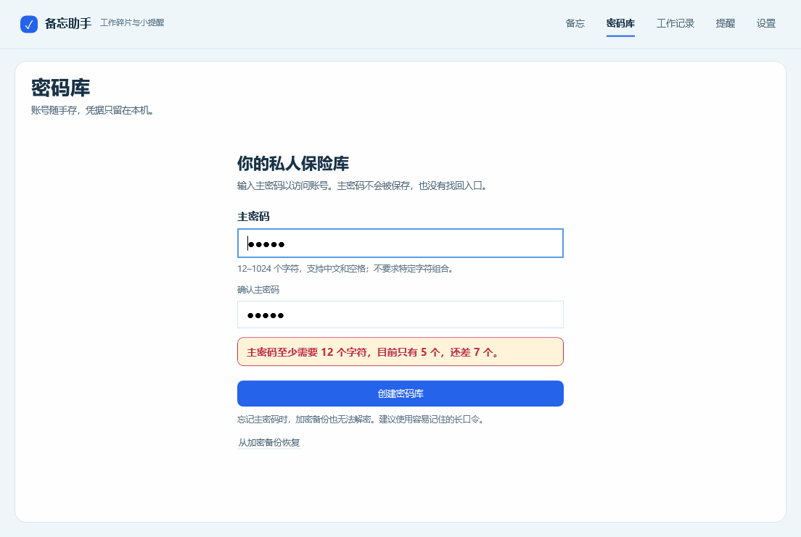

# 主密码校验提示修复

版本：0.10.1-preview；日期：2026-10-31。

原先提交不合要求的主密码时，输入会先清空，底部只显示混合“密码错误、格式错误、数据损坏”的通用消息，用户无法判断如何修改。

修复后：

- 创建页持续显示 12–1024 字符的要求，明确支持中文和空格，无需特定字符组合。
- 输入框附近用红色提示框说明空值、当前长度/还差多少、长度超限和确认不一致；定位到相应输入框。
- 格式错误在本地拦截，保留输入，不创建库文件；修改为有效内容后清除提示。
- 修改主密码、恢复备份和快捷解锁入口使用同一规则；主密码框不再静默截断超长输入。
- 新密码格式错误与已有密码验证失败使用不同错误类型，后者不再混入长度提示。

验证：249 项自动化测试通过，含新增 9 项主密码策略与后端错误分类检查；31 项实际 WPF 检查通过，含新增 9 项可见提示与输入保留检查。本轮使用替身剪贴板和隔离合成数据，不操作正式密码库或运行中的旧版程序。

原始结果：`artifacts/vault-validation/20261031-165626/results.json`。

可运行版本输出到 `artifacts/MemoDesk-0.10.1-preview-win-x64/`，与 0.10.0 目录分开。退出托盘中的旧版后再启动新版；密码库文件格式与主密码规则保持兼容。
