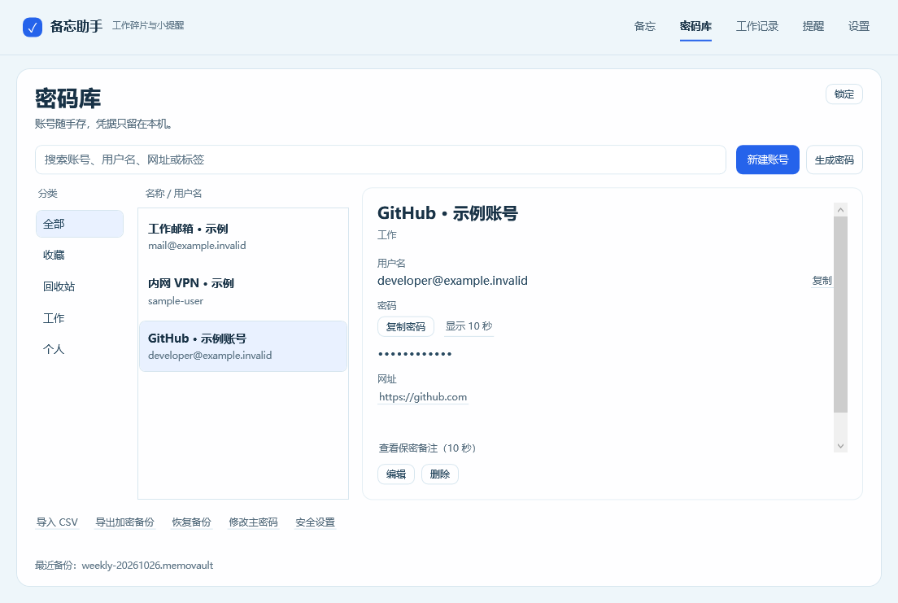
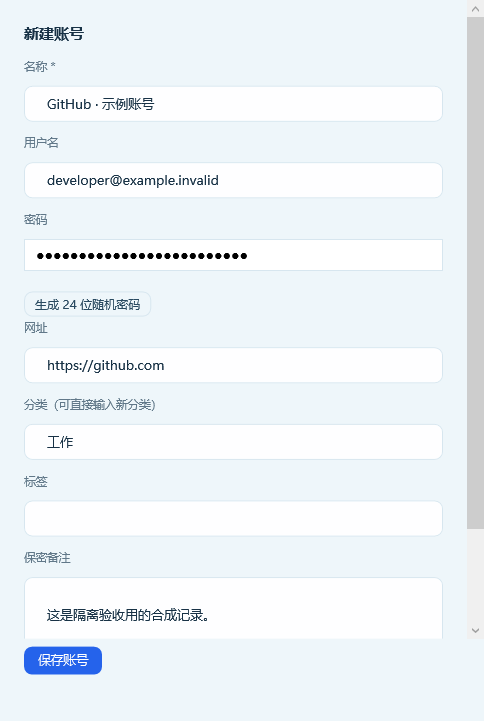
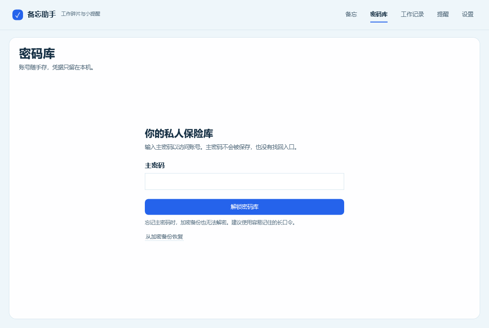

# 密码库首版验证记录

版本：0.10.0-preview；日期：2026-10-31；环境：Windows 11，OS build 26200，.NET 10，Release / win-x64。

## 已完成

- 解决方案构建成功，警告作为错误处理，0 警告 / 0 错误。
- 240 项自动化测试通过：原 Core 104、原 Infrastructure 107、Vault 29。
- 29 项实际 WPF / Windows 适配检查通过：使用生产 DI 组合、主窗口和密码库控件，以隔离数据库和合成账号执行。
- 校验了最小窗口尺寸下创建/恢复入口的可达性；编辑保存、搜索、显示清理、导入预览/提交、快捷检索与安全设置可用。
- 校验了隐藏、最小化、编辑中锁定、延迟解锁撤销和恢复后重新解锁；被外部数据库写锁阻塞时，会话撤销仍立即返回。
- 原生剪贴板的历史/云同步格式、复制、替换保护和定时清理通过；到期检查加速单调时钟，保留真实 Windows 定时器与剪贴板 API。此轮原剪贴板对象已恢复。
- 数据库、备份与临时文件没有测试凭据明文；账号操作不创建备忘或时间线记录；测试不启动 AI 后台工作器。
- 自包含发布目录检查通过：包含 exe、.NET 运行库、两个 Vault 模块及 LockerIt MIT 许可和第三方说明。

## 复验命令

从仓库根目录运行：

```powershell
dotnet test MemoDesk.sln -c Release
dotnet run --project tests/MemoDesk.Vault.UiProbe/MemoDesk.Vault.UiProbe.csproj -c Release -- --native-clipboard
dotnet publish src/MemoDesk.App/MemoDesk.App.csproj -c Release -r win-x64 --self-contained true -o artifacts/MemoDesk-0.10.0-preview-win-x64
```

原始窗口检查结果和控件渲染图位于 `artifacts/vault-validation/20261031-163927/`。
可运行目录为 `artifacts/MemoDesk-0.10.0-preview-win-x64/`，构建信息和模块 SHA256 见其中的 `BUILD-INFO.json`。

下列图片均为实际生产 WPF 控件，使用隔离的合成数据：







## 尚未验证的范围

本次没有启动整个生产应用生命周期、调用真实 AI、操作正式备忘或密码库、安装/签名 MSIX，也没有切换或锁定用户当前 Windows 会话。

Windows 10、真实系统锁屏/用户切换/休眠、多屏和跨屏 DPI、MSIX 安装后的完整流程仍需专项验收。本轮也不构成独立安全审计；密码库以预览功能交付。
